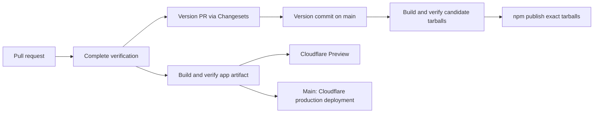

# npm release and Cloudflare deployment contract

Current release amendment, 2026-11-21: [ADR 0018](../adr/0018-use-one-ledger-container-for-concord.md)
sets five public products: Identity, Armour, Ledger, Concord and Seal. Ledger owns one
signed container and history lifecycle; Concord composes the framework above it.
Earlier internal-Ledger, public Tooling and UI-product requirements below are
superseded. Tooling, fixtures, apps and overlapping plans remain simplification work.

Status: target design, 2026-10-21. These are implementation instructions, not installed
workflows or authorization to publish today's checkout. Applies to all profiles in the
[repository architecture](repository-architecture.md). GitHub Actions owns production
automation; npm stores public packages and Cloudflare hosts applications.

## 1. Two independent delivery graphs

A package release and an app deployment have separate identities and lifecycles.
Package identity is name/version plus tarball integrity. App identity is app name,
source SHA, bundle digest, environment, and Cloudflare deployment/version identifier.
A UI component library is an npm product; its documentation/gallery is a hosted app.
The private board app's deployment must not publish every library it imports.

Changesets records public-package version intent. A merged application-only change can
deploy without a package release. A library change builds/tests affected apps against
the candidate packages, even when those apps are not deployed immediately. A deployment
receipt records exact package versions and candidate digests; it must not imply those
versions were already published if the application used verified workspace candidates.

Alpha package releases go to `next`. Stable `latest` promotion is explicit release
policy, not inferred from a commit message or version tag. Do not reset existing npm
names to a clean 0.0.1 or assume the checkout's manifest is ahead of the registry.
Use Changesets prerelease mode named `next` for the alpha and its generated pre.json
state; package prerelease versions and published internal ranges come from Changesets.
The registry dist-tag is a separate channel pointer, advanced only after verification.



## 2. Workflow responsibilities

| File                 | Trigger                                                                        | Work and outputs                                                                                                 | Privilege                                                                  |
| -------------------- | ------------------------------------------------------------------------------ | ---------------------------------------------------------------------------------------------------------------- | -------------------------------------------------------------------------- |
| ci.yml               | pull_request, main, merge_group when used                                      | Frozen install, all contract/gate checks, source SHA and candidate artifact manifest                             | contents read; no production secrets                                       |
| release-pr.yml       | main changes affecting public products/Changesets                              | Update one version PR using Changesets; changelogs, versions, lockfile and internal ranges                       | contents/PR write only here                                                |
| publish.yml          | Authorized release/version commit, or explicit retry dispatch for that commit  | Re-verify revision, create/check tarballs, publish missing exact versions, verify registry, record receipts/tags | contents read plus id-token write in publisher job; separate tag job write |
| deploy.yml           | main after complete same-SHA checks; explicit artifact retry/rollback dispatch | Verify app artifact digest, upload/deploy to configured production Worker, smoke test, record receipt            | Cloudflare production environment credential                               |
| preview.yml          | Eligible same-repo PR update, after checks                                     | Build immutable preview artifact, deploy isolated named Preview, probe, report URL                               | Cloudflare preview environment credential                                  |
| cleanup-preview.yml  | PR closed or explicit cleanup                                                  | Delete app-scoped preview, idempotently                                                                          | Preview credential; no PR code execution                                   |
| toolchain-canary.yml | Toolchain PR/manual/scheduled CI if enabled                                    | Compare checkers and profile compatibility, timing and memory reports                                            | Read-only; cannot publish/deploy                                           |

Use a single publisher workflow filename for all packages and a single deploy workflow
for all app matrix entries. New packages/apps join through validated manifest/config
discovery, not another copy of a workflow. No tag-triggered rebuild/publisher competes
with publish.yml. Tags/releases document successful publication; they do not trigger
it again. Remove the existing tag-per-package workflow chain at cutover.

The publish trigger uses a machine-readable release-plan diff in the version commit;
never `contains(head_commit.message, ...)` or parsed PR prose. A main run with no new
public versions exits as a recorded no-op after validation. A new version without a
valid Changesets plan fails. `workflow_dispatch` accepts a source SHA/release ID, not
arbitrary shell command, registry URL, filesystem path, or package-name override.

Changesets-generated version PRs must themselves receive required CI checks. Prefer a
repository-scoped GitHub App token if needed to trigger normal PR checks; GitHub's
default token has event-trigger restrictions. Provisioning that app is a one-time
repository task. Do not silently reuse a broad personal GH_TOKEN from the old setup.
[GitHub's trigger rules](https://docs.github.com/en/actions/how-tos/write-workflows/choose-when-workflows-run/trigger-a-workflow)
describe the current approval-required PR exception and normal GitHub App behavior.

Pin actions to reviewed immutable SHAs and dependency tools to exact versions. Setup
reads the repository runtime/package-manager pins, installs with a frozen lockfile,
and validates that the executing versions match. Avoid floating checkout@master,
deprecated outputs, shell parsing of PR titles, and install-time builds hidden in
prepare/prepack/publish hooks. The shared setup action performs setup only, not release.

Main publication and production app changes are serialized by release and app/environment
concurrency keys with cancellation disabled. PR checks/previews may cancel superseded
PR runs, but cleanup and stale-preview races must not delete or overwrite a newer
deployment. On upload, compare source SHA/PR state against the current candidate.

## 3. Immutable release plan and artifact proof

`.github/scripts/plan-release.mjs` discovers non-private manifests, reads the committed
version intent, and computes the changed release set and dependency publication order.
It is a thin adapter around Changesets and the tooling validator, not another versioning
algorithm. Output a plan with this logical shape:

```ts
type ReleasePlan = {
  schema: 1;
  sourceSha: string;
  lockfileSha256: string;
  toolchain: Record<string, string>; // exact Node, pnpm, npm, Vite+, checker versions
  channel: "next" | "latest";
  publishTag: string; // "candidate-" + first 12 hex characters of sourceSha
  packages: {
    name: string;
    version: string;
    file: string; // relative path inside the candidate artifact, no traversal
    sha256: string;
    integrity: string; // sha512 SRI of exact .tgz bytes
    dependencies: { name: string; version: string }[]; // exact in-release siblings
    gateReportSha256: string;
  }[]; // topologically sorted
};
```

SHA fields use lowercase hex; SRI is `sha512-` plus padded standard base64. The plan
is serialized using RFC 8785 for its own SHA-256 release ID. This automation metadata is
not Concord history and need not import Concord runtime/crypto. No npm credentials
are written into it. A discovery manifest may exist before building; the final plan
is immutable only after tarball and gate-report digests are filled.

Release steps:

1. Check out the exact eligible version commit. Validate clean install, graph, version
   changes, workspace ranges, export paths, public access, and required scripts. Run
   complete required source, type, behavior, build, and browser gates.
2. Build dependencies in graph order. Pack each public candidate exactly once using
   pnpm's workspace-range rewriting. Prohibit lifecycle hooks that rebuild/rewrite the
   package during pack or publish. Preserve tarballs and compute SHA-256/SRI.
3. Create an isolated temporary registry serving candidate sibling tarballs under their
   final names/versions. External installs resolve these candidates, not workspace symlinks
   or previously published siblings. Verify ranges, exports, declarations, CLI, browser,
   CSS, standalone tooling, and relevant compatibility fixtures against that set.
4. Write the finalized release plan and gate reports. Upload the immutable candidate
   artifact under source SHA/release ID. The publisher downloads exactly that artifact
   from the eligible workflow run and verifies all digests and provenance of the run.
   A PR artifact alone cannot authorize publication of main.
5. Query the registry before each publish. If name/version is absent, publish that
   exact tarball. If present with identical integrity, record it as already complete.
   If present with different integrity, fail VERSION_COLLISION. Do not overwrite,
   rebuild a tarball, invent a version, or continue to its consumers.
6. Publish dependency candidates before consumers, wait for the expected registry
   version/integrity to resolve with bounded retries, and run a fresh registry consumer
   smoke check. Publish initially under the plan's per-release candidate tag. After the
   complete set passes, move each package's intended next/latest dist-tag, recording
   prior/target values and results. Then write the success receipt and documentation
   tags/releases. Dist-tag promotion is itself non-atomic and retryable.

Use npm's supported tarball input, e.g.
`npm publish ./artifacts/<candidate>.tgz --access public --tag candidate-<sha12> --provenance`.
In implementation this is an argv invocation with validated paths and channel, not a
shell string interpolating package metadata. npm documents tarball publication and
immutable name/version combinations in [npm publish](https://docs.npmjs.com/cli/v11/commands/npm-publish/).
No `pnpm publish -r` repackaging after external-consumer checks.

A release set is not an atomic npm transaction. Journal each package's intended and
observed integrity, state, attempt, source SHA, and registry result. On a partial outage,
retry the same retained artifacts, skip identical completed versions, and resume in
dependency order. Do not mark the complete release successful or promote its channel
before all required publications and consumers succeed. `latest` remains untouched
by an alpha `next` release. Stable promotion needs a separately validated channel plan;
if a failure partly changes dist-tags, restore their recorded prior values where the
account permits it and report the remaining state. npm unpublish is not rollback.

Artifacts must outlive the intended retry window; record retention/expiry. Expired
missing bytes require a new verified candidate run and plan, never a claim that a
rebuild has the old digest. A retry that finds the same name/version in npm must
compare integrity, even if rebuilt source code appears identical.

## 4. npm identity and trust setup

Use GitHub-hosted publisher runners, npm trusted publishing/OIDC, and per-package
publisher configuration pointing at the actual owner/repository, `publish.yml`, and
the chosen GitHub environment. Authorize direct npm publish explicitly in npm's
current trusted-publisher settings; do not assume new defaults permit it. The documented
minimum is npm 11.5.1 and Node 22.14.0; pin a tested compatible current version, and
recheck the policy during implementation. See [npm trusted publishing](https://docs.npmjs.com/trusted-publishers/).

The OIDC publish command executes directly inside publish.yml, avoiding ambiguous
reusable-workflow identity matching. Only that job has id-token write; PR checks and
build jobs do not need it. npm trust configuration must match the environment used
by the job. Dist-tag updates need their own allowed action when performed through
trusted publishing. Public package manifests declare `publishConfig.access: "public"`;
private apps/fixtures/root are never eligible, and Changesets access changes to public.

First-package scope creation and any bootstrap publication/trust setup are a separate
explicit onboarding step if the registry requires them. Surface PACKAGE_NOT_CONFIGURED;
do not fall back to a broad stored NPM_TOKEN. Keep setup instructions and the exact
workflow identity in `docs/engineering/deployment-setup.md` when implementing R5.
No token values belong in repository files or diagnostic artifacts.

## 5. Cloudflare target and app artifact

Use Workers Static Assets for new stateless UI deployments. That supports the board
SPA and static docs with one Wrangler-based deployment family. No Concord backend,
transport service, D1, KV, R2, or Durable Object is required by the alpha. Existing Pages
sites can be assessed/migrated individually; this design does not delete their projects.
[Workers Static Assets](https://developers.cloudflare.com/workers/static-assets/).

Each private app owns a checked-in `wrangler.jsonc` with Worker name, pinned compatibility
date, asset output path, routing policy, and explicit preview settings. Account ID,
zone/domain mappings, and secrets are environment-specific deployment inputs. Application
code does not contain a personal Cloudflare account identifier or production credential.

Board's minimum source configuration shape:

```jsonc
{
  "name": "ternent-concord-board",
  "compatibility_date": "2026-10-21",
  "assets": {
    "directory": "./dist",
    "not_found_handling": "single-page-application",
  },
  "previews": {},
}
```

This records a proposed Worker name, not an assertion it exists in Sam's account. Docs
uses generated static files and a real 404 policy, rather than the board's SPA fallback.
Compatibility-date changes are reviewed and tested. The SPA profile checks navigation
and asset requests separately: a missing JS asset must not be accepted as a successful
HTML bundle load. [SPA routing contract](https://developers.cloudflare.com/workers/static-assets/routing/single-page-application/).

The app build creates an isolated deployment directory containing the exact `dist/`
tree, deploy-only Wrangler config, and `artifact.json` outside the public asset tree.
It contains source SHA, application name, public build settings, resolved package
versions/digests, sorted relative file paths and content digests, routing mode, and
compatibility date. No symlinks outside the artifact, absolute paths, or path traversal.
Copy only the files needed for deployment; no source config build hook, node_modules,
or `vite.config.ts` is present to trigger an accidental rebuild on the deploy runner.

The deploy job installs only pinned deployment tooling, restores the verified bundle,
checks its manifest/digests, and invokes Wrangler from that directory. It does not
install/build the application again. For static-only apps there is no Worker JS bundle
to recompile. If server code is later introduced, define and validate a prebundled
Worker artifact profile and the supported no-build Wrangler invocation before release.
Cloudflare's Vite plugin is appropriate for a proven Worker-runtime integration, not
necessary for a static-only Vue app. Do not imply Vite+ compatibility until tested.

Main deployment occurs only after complete checks for the same source SHA. Before
deployment, record the current production deployment/version and verify the candidate
is still eligible under the chosen main deployment ordering. Publish through the one
GitHub workflow rather than enabling a competing Cloudflare automatic Git build. Verify
root HTML, JS/CSS content types, a deep route, the build identifier, and browser startup.
Retain the previous artifact and Cloudflare receipt for rollback; version upload and
deployment can be separate operations. [Versions/deployments](https://developers.cloudflare.com/workers/versions-and-deployments/).

If smoke fails, restore the previously recorded compatible deployment/version and run
the same smoke checks. Record failed candidate and rollback result distinctly; do not
claim rollback merely because the command returned success. First deployment has no
previous production version and must report that condition. A successful npm package
release is not undone because a separately deployed app failed.

## 6. Preview and credential separation

Use current Worker Previews for PR environments. The documented CLI is
`wrangler preview --name pr-<number> --json`; its output supplies the Preview URL.
Delete on closure with `wrangler preview delete --name pr-<number> --skip-confirmation`.
Pin a tested Wrangler version at least 4.135.0 for this interface. These commands are
documented in [getting started](https://developers.cloudflare.com/workers/previews/get-started/)
and [GitHub Actions examples](https://developers.cloudflare.com/workers/previews/examples/).

For this stateless alpha, previews contain public app assets and synthetic examples,
with no production storage/service bindings or host identity keys. Preview configuration
must remain explicit if bindings are ever added: do not assume a preview isolates every
production resource automatically. UI users supply their own document/identity capability
locally. No seed is embedded in a client environment variable or deployed demo artifact.

Use distinct GitHub environments `cloudflare-preview`, `cloudflare-production`, and
`npm-release`. Cloudflare credentials are account-scoped API tokens with the resource
permissions required by the target apps; zone edits are granted only when domain setup
needs them. Keep account ID as a non-secret variable if appropriate and token as secret.
The exact token/account/worker mapping is supplied at onboarding, not guessed here.

Same-repository PRs may deploy previews under the repository's chosen environment
policy; fork PRs receive checks without credentials. Never execute PR source through
pull_request_target with deploy credentials. Cleanup uses trusted base-branch automation,
not a checkout of the closed PR. Preview URLs go to job summaries/deployment outputs;
posting PR comments is optional workflow behavior to enable explicitly at implementation.
No message or comment is sent as part of this design task.

Preview building and uploading are separate jobs. The credential-bearing uploader uses
trusted pinned automation and only the verified static artifact, not a PR-provided
package install, JS config, or script. Its target Worker and permitted configuration
fields are checked against the base repository's app registration; a PR artifact cannot
rename a production Worker or inject build hooks. This is a static-app contract; adding
executable Worker code or privileged bindings requires its own explicit profile proof.

Production policy is merge-to-main deployment after required checks for eligible apps.
Package release policy is merging the verified version PR. Once these workflows are
deliberately enabled by Sam, those repository events are their normal authorization;
do not introduce a manual approval on every routine run unless Sam chooses it. This
design alone does not configure an account or enable a production workflow today.

## 7. Failure contract and automation tests

Automation emits `{ code, phase, sourceSha, releaseId?, package?, app?, environment?,
message, retryable }` with useful exit status. Expected codes include
CONTRACT_INVALID, TOOLCHAIN_MISMATCH, GATE_FAILED, ARTIFACT_MISSING, DIGEST_MISMATCH,
PLAN_INVALID, VERSION_COLLISION, PACKAGE_NOT_CONFIGURED, REGISTRY_UNAVAILABLE,
PUBLISH_PARTIAL, DEPLOY_CONFIG_INVALID, DEPLOY_FAILED, SMOKE_FAILED, and ROLLBACK_FAILED.
Credentials and arbitrary package/PR text must never be interpolated as shell code.

| Acceptance case                                         | Required observation                                                                   |
| ------------------------------------------------------- | -------------------------------------------------------------------------------------- |
| Broken package main/export/bin/declaration/CSS          | Fails before any credential-bearing job                                                |
| Candidate sibling differs from registry predecessor     | Isolated consumer exercises candidate digest, never silently falls back                |
| Missing/changed artifact after checks                   | Publish/deploy refuses it; no rebuild under old release ID                             |
| Publication interrupted after first dependency          | Retry skips identical registry bytes and resumes remaining set                         |
| Existing same version with different integrity          | VERSION_COLLISION; consumers not published                                             |
| Registry propagation delayed                            | Bounded retry, then explicit incomplete state; no invented version                     |
| Package-private or unplanned new public version         | Never published; contract/plan fails                                                   |
| PR config/root/tooling/lockfile change                  | Full relevant profile graph reruns; no source-cache shortcut                           |
| Fork PR or closed PR                                    | No secrets to source; cleanup idempotent and base-trusted                              |
| UI deployment has wrong assets/deep-route/content types | Smoke fails and compatible previous deployment is restored/checked                     |
| Initial deployment fails                                | Explicit failure with no fictitious rollback target                                    |
| Main/publish retry race                                 | Serialized same release/app operations; journal/deployment receipt prevents duplicates |
| Same published package used in a second repository      | Tooling and runtime work without this checkout or private config                       |

Unit-test planner/journal/manifest logic with saved registry/Cloudflare responses and
argv-recording adapters. Use a dedicated test package/channel and test Worker for the
real OIDC/preview/deploy/rollback proof. Do not test live publication with production
versions merely to exercise retries. Before cutover, prove the entire Identity release
and a tiny static Vue app deployment, then add products through the same matrices.
