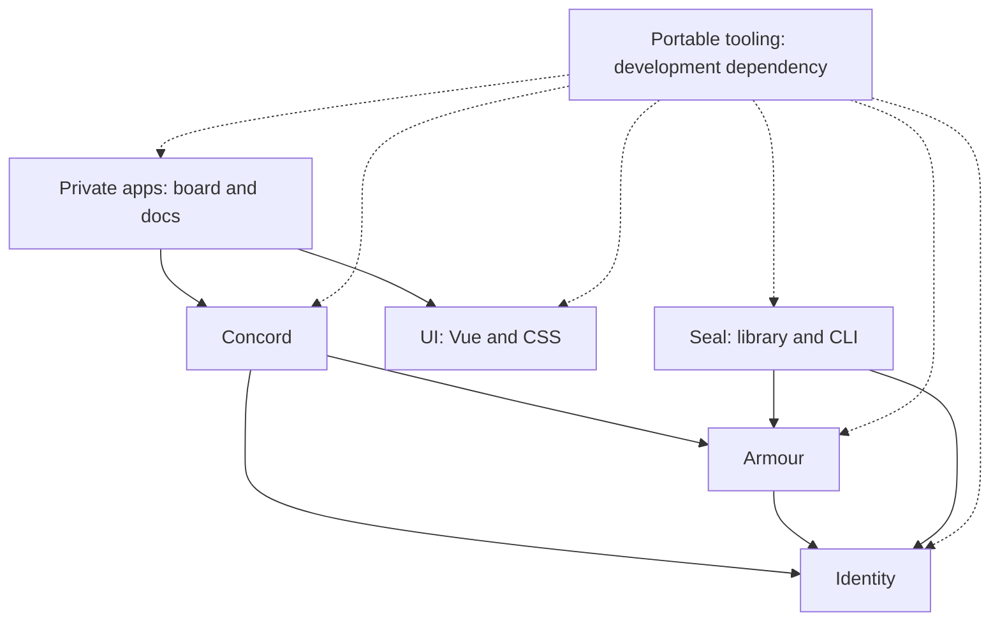

# Ternent repository architecture

Status: accepted target design, 2026-10-21; R1 implementation is described in
[the tooling pilot](tooling-pilot.md). Identity, Armour and the private Concord first slice are now active
([migration evidence](alpha-first-slice.md)); other product migration and account
provisioning remain later increments. This architecture may replace all current source, configuration, and
workflows. It preserves Concord's accepted document contracts and independently useful
products, not the half-migrated repository layout. It can be implemented in a clean
checkout of `ternent/core` without creating another GitHub repository first.

Read with the [package contract](package-tooling-contract.md),
[release/deployment contract](release-and-deployment.md),
[toolchain assessment](toolchain-assessment-2026-10-21.md), and
[Concord blueprint](../concord/implementation-blueprint.md). ADRs 0010–0012 record
the durable infrastructure decisions. This document specifies the next layer below
that blueprint's Step 0.

## 1. Repository and products

Keep one pnpm workspace, independently versioned npm packages, and private deployable
applications. Every new code directory belongs to a declared workspace package or
the small repository automation area. The root is private and cannot be published.
All publishable libraries, CLI outputs, UI components, and portable tooling ship to
npm. Applications consume those packages and ship to Cloudflare; they are private npm
workspaces, not accidental public application-source distributions.

```text
ternent/core/
  AGENTS.md
  CONTEXT.md
  package.json                   private root; exact packageManager pin
  pnpm-workspace.yaml            packages/*, apps/*, tooling/*, fixtures/*
  pnpm-lock.yaml
  .node-version                  exact development/CI runtime
  .npmrc                         registry/install policy; no credentials
  vite.config.ts                 root fmt/lint policy and repository tasks
  tsconfig.json                  root references; no sibling-source aliases
  .changeset/                    independent package release intent
  .github/
    workflows/
      ci.yml
      release-pr.yml
      publish.yml
      deploy.yml
      preview.yml
      cleanup-preview.yml
      toolchain-canary.yml
    actions/setup/action.yml     pinned runtime/package manager/install
    scripts/                     JSDoc-checked ESM; thin release/deploy adapters
  packages/
    identity/                    @ternent/identity
    armour/                      @ternent/armour
    seal/                        @ternent/seal, including its Node bin
    concord/                     @ternent/concord and specialist subpaths
    ui/                          @ternent/ui; Vue components, CSS, tokens
  apps/
    concord-board/               @ternent/app-concord-board; private Vue SPA
    docs/                        @ternent/app-docs; private static documentation/gallery
  tooling/
    tooling/                     @ternent/tooling; publishable dev-only presets/validators
  fixtures/
    package-consumers/           private fixture workspace; creates isolated installations
    tooling-profiles/            private library/CLI/Vue/app/bootstrap regression fixtures
  docs/
    concord/                     normative protocol and conformance artifacts
    adr/
    engineering/
    site/                        authored documentation source consumed by apps/docs
  artifacts/                     ignored, disposable candidate/release outputs
```

Create packages/apps only as their implementation starts. The tree is the final
inventory, not a request for empty stubs. Register-model and board-model example code
live with Concord's examples/testing and the board app as described in its blueprint;
there is no new public application-model package merely to fill this tree.

There is no target public Ledger, Workspace, Concord-protocol package, catch-all Utils,
or blanket integrations package. Legacy Utils functions move to the owning module
unless two independent real consumers justify a small public contract. Seal may keep
an internal utility module. A future storage/framework adapter earns a package through
actual dependencies and use, and adopts these same tooling profiles.

UI is a reusable presentation product. Its public interface must not depend on Identity,
Armour, or Concord types. Applications translate domain identities/facts into UI props.
Vue is a peer dependency of UI and an app dependency of Vue applications. CSS is an
explicit export; CSS-bearing modules are marked for side effects. A browser app using
UI must prove styling survives production tree shaking.

The clean target uses Vue 3 and TypeScript for the board, with VitePress for static
documentation/gallery. VitePress is a narrow framework profile: its supported build
integration is proven in the pilot instead of assuming a Vite+ application command
can build it. No UI framework replacement is necessary to achieve consistent tooling.



Arrows mean dependency, not data flow. Concord's protocol-only subpath has no runtime
import of Armour, system extensions, model code, or UI. Identity has no Armour import.
No library imports an app. Tooling has no runtime-product dependency. Imports between
packages use declared public exports and `workspace:^` for candidate runtime/peer
relationships; internal private test-only workspaces may use `workspace:*`.

## 2. One toolchain contract, a few real profiles

Adopt project-local Vite+ as the default toolchain interface. Its documented interface
combines Vite, Rolldown, tsdown, Vitest, Oxfmt, Oxlint, and task scheduling. Keep pnpm
as the pinned dependency/lockfile owner. A global `vp` installation is optional and
never a CI prerequisite. See the [Vite+ guide](https://viteplus.dev/guide/).

| Responsibility                          | Target owner                        | Guarantee                                                                   |
| --------------------------------------- | ----------------------------------- | --------------------------------------------------------------------------- |
| Formatting                              | Vite+ / Oxfmt                       | Root policy; explicit read-only check and explicit fix command              |
| Correctness lint                        | Vite+ / Oxlint                      | Root rules, visible unsupported-file exceptions, zero unexpected warnings   |
| Typed lint                              | Oxlint/tsgolint                     | Dependencies' declarations resolved; no silent exclusion of a TS project    |
| Type correctness                        | Explicit profile-specific checker   | Authoritative checker selected by equivalence tests; Vue templates included |
| Library/CLI JavaScript and declarations | `vp pack` / tsdown / Rolldown       | Explicit entry/output mapping, ESM, sourcemaps, usable declarations         |
| Vue component library                   | Same pack path with Vue recipe      | Vue SFC compilation, declarations, CSS, framework peers                     |
| Application development/build           | `vp dev`, `vp build`                | Vue app HMR and deterministic deployable output                             |
| Documentation build                     | VitePress profile                   | Static output and checked examples; no forced unsupported integration       |
| Behavior tests                          | `vp test run` / Vitest              | One-shot failure status; watch is a separate command                        |
| Browser interaction and consumer proof  | Playwright plus isolated fixture    | Actual browser execution, packed imports, CSS and crypto behavior           |
| Graph and cache                         | `vp run` / Vite Task                | Dependency ordering without another task runner                             |
| Versions and release intent             | Changesets                          | Independently versioned public packages and dependency updates              |
| Deployment                              | Pinned Wrangler from GitHub Actions | Checked Cloudflare artifacts and deployment receipts                        |

Oxc's parser, resolver, transformer, and minifier are consumed through the toolchain;
do not add one direct package per Oxc feature without a concrete caller. No Nx, Turbo,
separate ESLint/Prettier stack, custom general scheduler, or Rust build prerequisite is
needed for these profiles. A small documented adapter for a demonstrated framework gap
is allowed and must have a fixture; consistency means the same promises and commands.

`vp pack` is a library **build**, not creation of the final npm tarball. Its `pack`
configuration belongs in `vite.config.ts`. The actual candidate is subsequently made
with `pnpm pack`, validated, installed, and published unchanged. These are different
steps. [Library build documentation](https://viteplus.dev/guide/pack).

Use the [tsdown Vue recipe](https://tsdown.dev/recipes/vue-support) inside the Vue
profile: `unplugin-vue/rolldown` and Vue declaration support. `vue-tsc --noEmit` remains
the authoritative full Vue type gate until a replacement proves equivalent template
and declaration behavior. Do not combine an unrelated second Vite copy through aliases
just to make a plugin install. The profile pilot must validate actual peer resolution.

### Type checking and tsrs

The [Cloudflare announcement](https://blog.cloudflare.com/typescript-rust-port) describes
tsrs as an experimental TypeScript Rust port incubated with Oxc, with upstream compatibility
work continuing. Use it in a non-publishing canary lane first. Rust implementation and
upstream benchmark numbers are not repository correctness or performance evidence.

Initial plain TypeScript authority is pinned upstream `tsc --noEmit`; Vite+'s typed
lint uses its supported Go-based type engine. Configure `lint.options.typeAware: true`
and `typeCheck: false` initially so lint does not silently become a second authority.
During the pilot compare upstream diagnostics, Vite+'s type-check mode, and tsrs on
the same complete project graph, intentional failures, and declaration-consumer fixtures.
Promote the Vite+/Go checker only after equivalence; the explicit `typecheck` task can
then use `vp check --no-fmt --no-lint` with typeCheck enabled. Typed lint remains
separately reportable. Keep the Vue checker when it covers a different language surface.
The [Vite+ check contract](https://viteplus.dev/guide/check) explains its Go-powered path.

`tsrs` promotion requires zero unexplained diagnostic differences, all declarations and
consumers passing, an editor-compatible workflow, and measured cold/warm behavior on
this repository. Pin its exact accepted release, change the one checker profile, and
record the decision. Until then, tsrs cannot approve or block an npm/Cloudflare release.
No plan to run builds on Workers/Wasm is needed merely because the compiler can do so.

## 3. Portable tooling module

`@ternent/tooling` is an independently publishable development-only module. It owns:

- Root-policy and library/CLI/Vue/app/docs config factories.
- TS config presets for neutral libraries, Node tools, Vue, and framework consumers.
- Manifest/graph/export/asset/dependency checks and packed-artifact validation.
- Small generators for those same profiles, validated against real fixture projects.

It does not own application logic, product releases, Cloudflare account names, or a new
compiler/scheduler. Repository workflow scripts call the standard tools and its artifact
validators. A different personal repository can install a released tooling version and
use the same profiles without importing this checkout or a work-specific agent setup.

Its exports are `@ternent/tooling/config`, `/tsconfig/*`, and `/validation`, with bin
`ternent-tooling`. Config implementation and CLI are plain executable ESM with JSDoc
types; publish `src/*.mjs`, `bin/`, hand-authored public `types/*.d.ts`, and config
assets directly. Export maps place types before import targets. This is the single
explicit no-build-bootstrap exception to the normal `dist` rule. Its own build checks
the declared artifact rather than compiling a dependency needed to read its config.
It tests itself through its package exports and isolated installation. No runtime
package needs to depend on it; development peers and profile-plugin requirements are
declared explicitly, not supplied accidentally by hoisting.
Declaration/type-consumer fixtures check that the small hand-authored interface matches
the implementation; plain ESM does not exempt it from TypeScript-consumer checks.

Each consumer imports a config factory by public package name. A leaf's configuration
contains only its source entries and genuine options: Vue/CSS handling or app
entry. `package.json` remains authoritative for public exports, peers, bin, engines,
files, and publish eligibility. Validate the config/manifest pair rather than copying
metadata into a second inventory. Source entry mapping is build input, not a second
package-export registry.

The manifest adds only `ternent.profile` for discovery, one of `ts-library`, `node-cli`,
`vue-library`, `vue-app`, `docs-app`, `tooling`, or `fixtures`. A package with both a
library and a Node bin uses node-cli. The corresponding config factories are
defineLibrary, defineCliLibrary, defineVueLibrary, defineApp, defineDocs, and
defineWorkspace. They accept source entry maps and profile-specific build inputs
(Vue CSS sources or a docs source directory); public exports/bin/framework peers and
runtime dependencies remain manifest-owned. Unknown profile fields fail validation.
defineDocs returns Vite+ gate/task configuration; content/navigation settings stay
in the app's VitePress config. The tooling/fixture profiles are bootstrap and consumer
harness variants, not a public runtime plugin system.

Example library build description:

```ts
import { defineLibrary } from "@ternent/tooling/config";

export default defineLibrary({
  entry: {
    index: "src/index.ts",
    "protocol/index": "src/protocol/index.ts",
    "system/index": "src/system/index.ts",
    "testing/index": "src/testing/index.ts",
  },
});
```

Factories return the pinned Vite+ configuration type. Normal output is neutral ESM,
ES2022, `dist/<entry>.js` plus `.d.ts`/sourcemaps, no production minification for
libraries, and declared dependencies/peers externalized. The Node CLI profile emits
a real executable JS bin with shebang and permissions; no native executable requirement.
Vue's peer and CSS overrides are explicit. Build profiles never generate `package.json`
by guessing its exports or bundle runtime siblings into each other.

Root `vite.config.ts` is the single fmt/lint policy using Vite+'s `fmt` and `lint`
blocks. Package overrides are in root overrides, not competing lint/formatter files.
The [formatter contract](https://viteplus.dev/guide/fmt) supports this arrangement.
Scope fix commands to changed files. Start with correctness rules and a small typed
set including unhandled promises; check the pinned rule list and Vue/template coverage.
Template correctness is also exercised by vue-tsc and browser tests. Record any missing
lint class explicitly; no green report may claim linted templates if it only saw script.

## 4. Commands and task graph

Every workspace exposes `fmt:check`, `lint`, `typecheck`, `test`, `build`,
`check:artifact`, and `check`. Publishing packages also expose `check:package` as an
alias of their npm artifact proof. `dev` and `test:watch` are optional explicit watch
commands. Private fixture workspaces have the same promises using their fixture profile.
Root-owned automation/config scripts are included in root format/lint/type/test scopes.

| Command        | Library implementation             | Application implementation                                                 |
| -------------- | ---------------------------------- | -------------------------------------------------------------------------- |
| fmt:check      | `vp fmt --check`                   | Same root policy                                                           |
| lint           | `vp lint --type-aware`             | Same, plus explicit framework coverage policy                              |
| typecheck      | Selected TS checker                | Vue checker or documented framework checker                                |
| test           | `vp test run`                      | Vitest behavior plus separate browser task                                 |
| build          | `vp pack`                          | `vp build`, or VitePress in docs profile                                   |
| check:artifact | Validate/install exact npm tarball | Validate exact asset bundle, routes, deployment config and browser startup |
| check          | `vp run verify`                    | Same graph semantics                                                       |

Root `pnpm check` invokes the root verification task: validate inventory, then run
workspace `verify` tasks via Vite Task and root automation checks. Leaf package scripts
own individual tool invocations. Shared profile factories own task dependencies. A task
name is defined either as a package script or in `run.tasks`, never both. In particular
the `verify` task exists only in config and depends on the named script tasks; its own
command validates the package contract and emits the gate summary.

The factory defines internal task names, preserving leaf scripts as single-package
operations. `build-ready` runs `pnpm run build` after dependency `build-ready` tasks;
`types-ready`, `lint-ready`, and `tests-ready` run their corresponding scripts after
dependency builds, including declared test-only/typed-lint inputs where relevant.
`artifact-ready` waits for build-ready, types-ready, tests-ready and the root
`candidate-pack` task, then runs
`pnpm run check:artifact`. `verify` waits for artifact-ready, fmt:check and lint-ready, then
validates/emits the complete gate summary. Root candidate-pack waits for public-package
build-ready tasks and packs the candidate set exactly once. None of these internal task
names is also a package script. There is no dependency from a build back to verify.

Task prerequisites:

1. Repository contract validation precedes all package work: missing scripts, duplicate
   package names, invalid exports, forbidden dependencies, cycles, and unclassified
   code fail early. Missing tasks/packages are errors, not skipped checks.
   This phase validates declarations, not the existence of not-yet-built dist files;
   concrete output/asset existence is checked after build and again inside the tarball.
2. A package build requires builds of its declared imported workspace dependencies and
   relevant local peers. Tests and typed checks require their dependency declarations.
   No package build recursively invokes sibling builds itself.
3. Artifact proof requires the package build, typecheck, and behavior checks. Candidate
   tarballs of affected siblings are supplied together. App proof waits for its library
   dependency outputs. Root verification includes browser and fixture obligations.
4. Full CI/release verifies the complete workspace initially. An affected-only developer
   command may use reverse-dependent closure plus dependency prerequisites. Changes to
   root policy, tooling, lockfile, profile factory, or global fixtures invalidate all.

Vite Task supports package task dependencies and typed dependency-field selection;
use its actual documented object syntax rather than Turbo's `^build` convention.
For example, the factory-generated build-ready task may depend on
`{ task: "build-ready", from: ["dependencies", "peerDependencies"] }`.
Imports used by tests may additionally require selected dev dependencies. Do not include
the tooling bootstrap build in a cycle. See [task scheduling](https://viteplus.dev/guide/run).
Filtered invocations must use `--fail-if-no-match`; an empty selection cannot pass CI.

Local source tests may import their own module sources, but sibling imports resolve
the package's real public built exports. Final consumers are installed outside the
workspace with no TS paths aliases, source aliases, or inherited root node_modules.
R1 uses exact-name candidate overrides in a temporary external installation
([ADR 0013](../adr/0013-pilot-candidate-isolation.md)). The release lane adds an
ephemeral Verdaccio registry containing the exact tarballs, with unrelated dependencies served from the declared registry. Generate
exact-name routes for every candidate, with no upstream fallback for those names;
a missing candidate version must fail. Use a pinned Verdaccio version, a loopback-only
port and a temporary data directory for this test infrastructure.

### Cache and diagnostic policy

Start with dependency/install caching and reproducible builds; add task caching after
the pilot demonstrates restored outputs and correct invalidation. Vite+ config tasks
may cache by default, so factories explicitly set policy instead of inheriting it.
Never cache publishing, Cloudflare operations, registry probes, or release journals.
Release artifact verification runs against the actual candidate output regardless of
a previous source-test cache result.

Cache identity includes toolchain versions, lockfile, source/config, applicable env
values, normative vectors, generated inputs, and dependency artifact digests. Only
declared public build-time client settings enter a UI cache key; credentials are not
build inputs. Test cache excludes nondeterministic integration/network probes. If file
tracking or restoration misses a required input/output, leave that task uncached until
a fixture establishes the correction. Cross-PR caches must not promote untrusted
artifacts into a release without verification.

Report format/lint/types/behavior/build/consumer/browser outcomes independently with
package, tool version, exit code, elapsed time, cache state, and diagnostic source.
Store machine-readable JSON plus a human summary. Preserve error paths and exit status.
No benchmark or speed claim precedes a measured baseline on identical checked scope.

## 5. Runtime, install, and configuration policy

Use one current supported Node 24 patch for development/CI/release, pinned exactly in
`.node-version`; keep the published library Node 22/24 promise separately. Vite+'s
current test runtime requires recent Node minors, so test lower supported library
runtimes through isolated built consumers without loading the development runner.
The [Vite+ test guide](https://viteplus.dev/guide/test) currently documents
`^22.18.0 || ^24.11.0 || >=26.0.0`. The new tooling profile therefore requires at least
Node 24.11 for its primary lane; the bootstrap picks a current Node 24 patch, not an
old patch merely because it satisfies that minimum.

Pin exact package-manager, Vite+, compiler, Vue checker/plugin, Wrangler, Changesets,
Playwright, and artifact-validation versions. Vite+ 1.3.0 is installed in the R1 pilot; its exact supporting pins and verification
evidence are recorded in [the pilot report](tooling-pilot.md). Compatible transitive tool versions
remain resolved by the committed lockfile. Do not override bundled Vite/Vitest/Oxc
versions independently by default. Dependency updates are one reviewed toolchain PR
with profile fixtures and consumer proof. CI never installs an unpinned `latest`.

One pnpm lockfile, frozen CI installation, explicit dependency build-script allowlist,
and declared workspace membership replace hidden exclusions and per-package lockfiles.
Use the chosen pnpm version's documented settings; verify allowlist behavior in a
fixture before depending on it. For generated/browser-only code, declare the producer
and validation scope explicitly. Never rely on ignored generated files existing on a
developer machine.

Browser/Node-neutral product source uses platform-neutral primitives. Separate Node
CLI exports from browser library exports. Each export states its environment; tests
prove no Node global is pulled into a browser bundle. A future Worker-specific adapter
uses workerd fixtures and explicit bindings; it does not make Cloudflare a dependency
of portable Concord documents.

## 6. Replacement and acceptance sequence

| Increment | Concrete deliverable                                                                  | Required proof                                                                                                                        |
| --------- | ------------------------------------------------------------------------------------- | ------------------------------------------------------------------------------------------------------------------------------------- |
| R0        | Snapshot old sources/manifests/workflows and candidate exports; retain existing edits | Recoverable Git history and a migration map; no source deletion before owner assigned                                                 |
| R1        | Plain-ESM tooling package, pinned workspace, library/CLI/Vue/app/docs fixtures        | Clean install from empty artifact directories; portable packed tooling works outside workspace; all profile commands fail usefully    |
| R2        | Identity pilot and exact candidate tarball                                            | New package behavior, types, imports, browser/Node consumers, normative identity vectors; deliberate malformed package rejected       |
| R3        | Armour and Concord first slice                                                        | Real local dependency graph, private owner fixture and complete create/open path; no registry predecessor substitution                |
| R4        | Rebuilt Seal and UI, docs and board apps                                              | CLI/library separation, standalone Seal Action consumer assessment, Vue declarations/CSS and browser behavior                         |
| R5        | GitHub release/deploy automation in a test environment                                | Candidate digests preserved, OIDC identity proven, reruns/partial failures tested, Cloudflare preview + production smoke and rollback |
| R6        | Cut over and remove old tooling/source owners                                         | Complete workspace checks, retained published compatibility decisions, no duplicate live publisher/deployer, documented first release |

Do not migrate every old Vite/Vitest version just to delete the result afterward.
Build clean target packages with the chosen profiles and port only behavior/contracts
that remain intentional. Preserve fixed Concord vectors throughout. Existing npm names
cannot be republished at old versions: allocate compatible new versions through the
release planner and mark breaking alpha interfaces clearly. Repository extraction or
a GitHub repository rename is optional later, not a prerequisite for this design.

Completion means a clean clone can install once, verify all classified code, pack every
public product, run isolated consumers, build every app, and hand checked artifacts to
the single npm/Cloudflare workflow. A second personal repository must install the
published tooling and build one library and one UI app without this root checkout.
No product decision blocks R1. Actual Cloudflare account/worker/domain and npm trust
configuration are deployment inputs collected when R5 is implemented.
